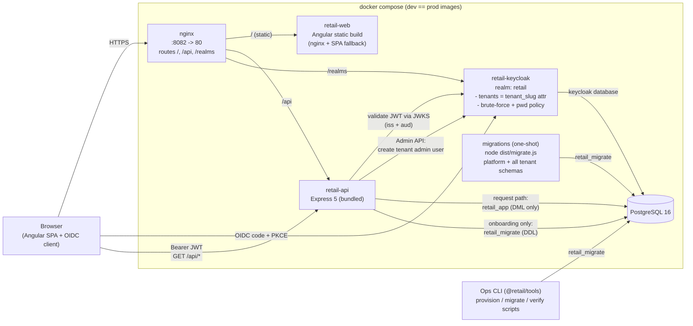
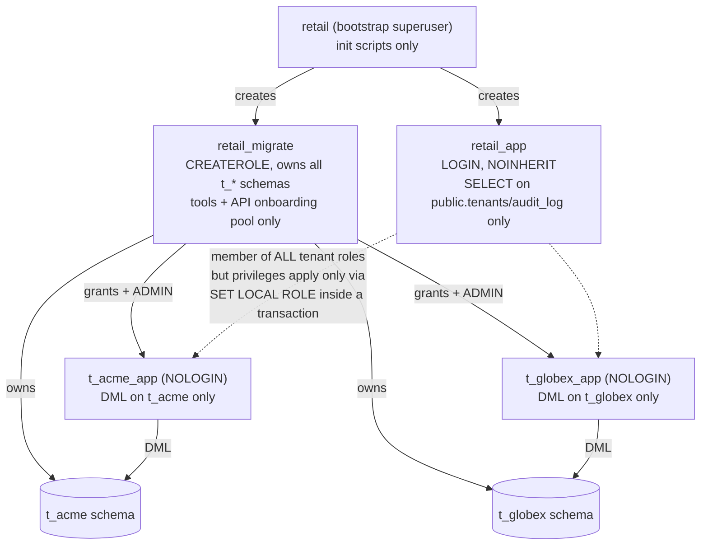

# Architecture

Multi-tenant SaaS for SMBs (retail domain). Schema-per-tenant PostgreSQL, Keycloak IAM, Angular + Express, one Docker image per app in every environment.

## System overview



## Components

| Component | Responsibility |
|---|---|
| **nginx** (outer) | Single origin: `/` -> SPA, `/api` -> API, `/realms` -> Keycloak. Sets `X-Forwarded-*` so the OIDC issuer is origin-relative (identical in every environment). |
| **retail-web** | Angular static build served by its own nginx (SPA fallback). OIDC: authorization code + PKCE, refresh tokens, bearer interceptor, route guards. |
| **retail-api** | Express 5 modular monolith. `authJwt` (JWKS/iss/aud) -> `tenantContext` -> business modules: `health`, `me`, `tenants`, `onboarding` (public signup). |
| **retail-keycloak** | IAM. Single realm `retail`; tenant membership = `tenant_slug` user attribute mapped into JWT claims. Realm-as-code in `infrastructure/keycloak/realm-export.json` (password policy + brute-force included). |
| **PostgreSQL** | `public` schema = platform data (`tenants` registry, `audit_log`, `platform_migrations`). One schema per tenant (`t_<slug>`) with a dedicated NOLOGIN role. |
| **migrations** | One-shot compose service (same API image): applies platform + all tenant schemas before the API starts. |
| **@retail/tools** | Ops CLI: provisioning, migrations, and the live verification scripts (`test:isolation`, `verify:auth`, `verify:onboarding`). |
| **@retail/provisioning** | Shared tenant-lifecycle core (schema + per-tenant role + migrations + registry), used by both the API onboarding module and the CLI. |

## Onboarding flow (public signup)

```mermaid
sequenceDiagram
    participant B as Browser (/signup)
    participant A as API
    participant K as Keycloak (Admin API)
    participant D as PostgreSQL (retail_migrate)

    B->>A: POST /api/onboarding/signup<br/>{companyName, slug, adminEmail, adminPassword}
    A->>A: zod validate + slug/reserved checks + rate limit (per IP)
    A->>D: slug free? (public.tenants)
    A->>K: admin token (bootstrap admin, cached)
    A->>K: email already used?
    A->>D: BEGIN; CREATE SCHEMA t_<slug>; CREATE ROLE t_<slug>_app; grants; COMMIT
    A->>D: node-pg-migrate (tenant migrations) + registry row + seed
    A->>K: create user (tenant_slug attr, tenant-admin role)
    Note over A,D: on user-creation failure: dropTenant (compensating cleanup)
    A-->>B: 201 {slug, name, adminEmail, tenantId}
    B->>K: login with the new credentials (code + PKCE)
    K-->>B: JWT with tenant_slug + tenant-admin
```

## Authenticated tenant request

```mermaid
sequenceDiagram
    participant B as Browser
    participant A as API
    participant K as Keycloak
    participant D as PostgreSQL

    B->>K: login (OIDC code + PKCE)
    K-->>B: tokens (claims: sub, tenant_slug, realm_access.roles)
    B->>A: GET /api/tenants/current (Authorization: Bearer)
    A->>K: JWKS signature check (cached) + iss/aud validation
    A->>A: req.auth = { sub, tenantSlug, roles }
    A->>D: tenantContext: registry lookup (cached 30s)
    A->>D: BEGIN; SET LOCAL search_path TO t_<slug>, public;<br/>SET LOCAL ROLE t_<slug>_app; ... COMMIT
    Note over D: SET LOCAL reverts on commit/rollback -<br/>no schema or role can leak between requests
    A-->>B: JSON
```

## Database security model (DB-003)



Key properties:

- The API request path **never** holds tenant privileges outside a transaction (`retail_app` is NOINHERIT; tenant rights activate only via `SET LOCAL ROLE`, which reverts at transaction end).
- Even a SQL injection inside a tenant transaction cannot read another tenant's schema (proven by `pnpm --filter @retail/tools test:isolation`).
- The registry (`public.tenants`) and audit log are the only cross-tenant tables the app role can touch (SELECT / INSERT respectively).

## Dev/prod parity

One image per app is built once and runs everywhere; only environment variables differ (`JWT_ISSUER_URL`, `KEYCLOAK_URL`, DB credentials, `MIGRATIONS_DIR`). Hot reload happens on the host; the Docker stack always runs the production-like build.

## Known deferred hardening

See `TECH_DEBT.md` (Keycloak production mode, scoped onboarding client instead of bootstrap admin, distributed rate limiting, CSP/security headers, backups).

